<div align="center">


# Ensayo coral

**Ensaya tu cuerda de coro con el micrófono.**<br>
Tu voz se dibuja sobre la partitura y enciende cada nota que afinas, mientras suenan las otras voces.

### [Abrir la aplicación](https://joseaveleira.github.io/ensayo-coral/)

[Tutorial](#tutorial-tu-primer-ensayo) · [Más opciones](#más-cosas-que-puedes-hacer) · [Instalarla](#instalarla-en-tu-ordenador) · [Cómo funciona](#cómo-funciona)

[](https://joseaveleira.github.io/ensayo-coral/)


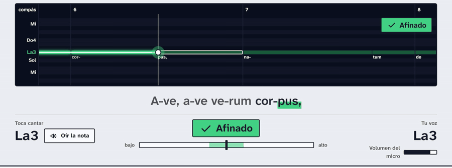

</div>

Primera obra: *Ave verum corpus* de Mozart (K. 618), a cuatro voces. La aplicación hace dos cosas:

- **Mi voz** mide tu nota más grave y la más aguda, y te dice qué cuerda te encaja.
- **Ensayo** hace sonar las otras voces, dibuja tu voz en tiempo real sobre las notas de tu cuerda y te dice si vas afinado, alto o bajo.

Funciona en el navegador, en ordenador y en móvil, sin instalar nada. Todo el sonido es sintetizado: no hay grabaciones. Lo que cantas se analiza en tu propio equipo; no se graba ni se envía a ningún sitio.

## Tutorial: tu primer ensayo

Necesitas un micrófono (el del portátil o el del móvil sirve) y, si puedes, auriculares.

### 1. Abre la aplicación y pulsa «Probar mi voz»

Entra en **[joseaveleira.github.io/ensayo-coral](https://joseaveleira.github.io/ensayo-coral/)**. El navegador te pedirá permiso para usar el micrófono: acéptalo.

Verás cuatro ventanales, uno por cuerda. Cada cristal es una nota que esa cuerda canta en la obra.

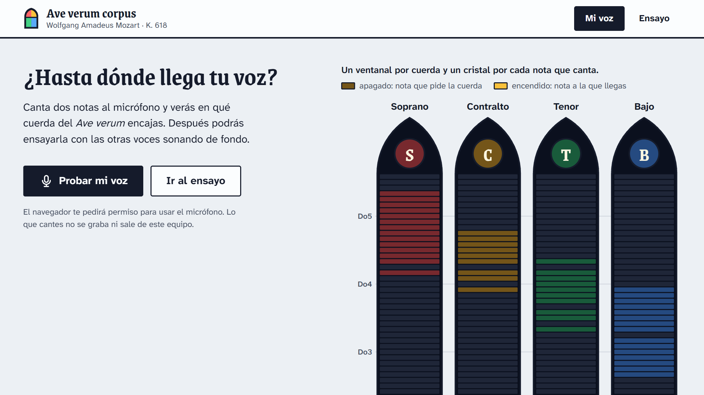

### 2. Canta tu nota más grave

Di «aaa» y ve bajando poco a poco, como una sirena. Cuando llegues a la nota más grave que te salga cómoda, mantenla un segundo. Una raya de luz cruza los ventanales a la altura de lo que cantas, y la aplicación apunta la más grave que te ha oído.

Cuando esté, pulsa **«Listo, siguiente»**. Si se ha colado un ruido, **«Borrar y repetir»**.

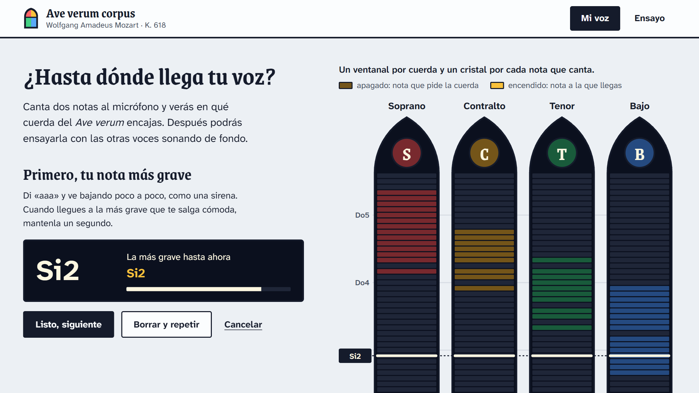

### 3. Ahora, la más aguda

Lo mismo hacia arriba: sube sin forzar y mantén la nota más aguda que te salga. Pulsa **«Listo, ver resultado»**.

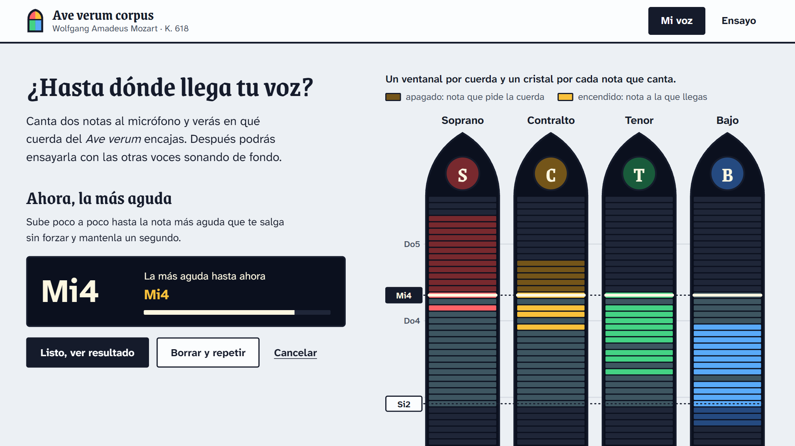

### 4. Mira qué cuerda te encaja

Los cristales encendidos son las notas a las que llegas. La cuerda que mejor te va queda marcada con **«Tu cuerda»**, y debajo se lee cuántas notas te faltan en las demás.

Pulsa **«Ensayar Tenor»** (o la cuerda que te haya salido). Si en tu coro cantas otra, podrás cambiarla en la pantalla siguiente.

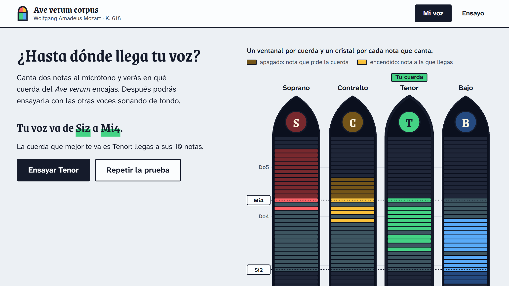

### 5. Pulsa «Empezar» y espera tu entrada

Estás en la pantalla de ensayo. Arriba eliges cuerda; en el centro está la partitura de tu cuerda, con una barra por nota y su sílaba debajo.

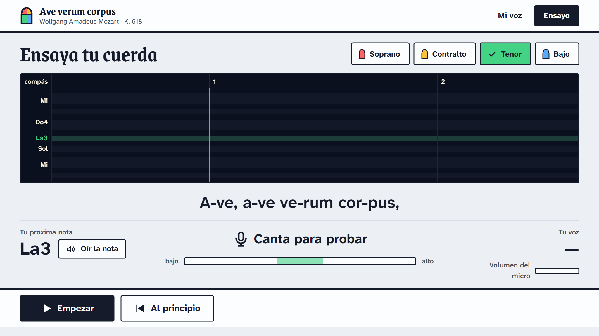

Al pulsar **«Empezar»** suena la introducción de las cuerdas. Un aviso cuenta los pulsos que faltan para tu entrada: «Entras en 3», 2, 1…

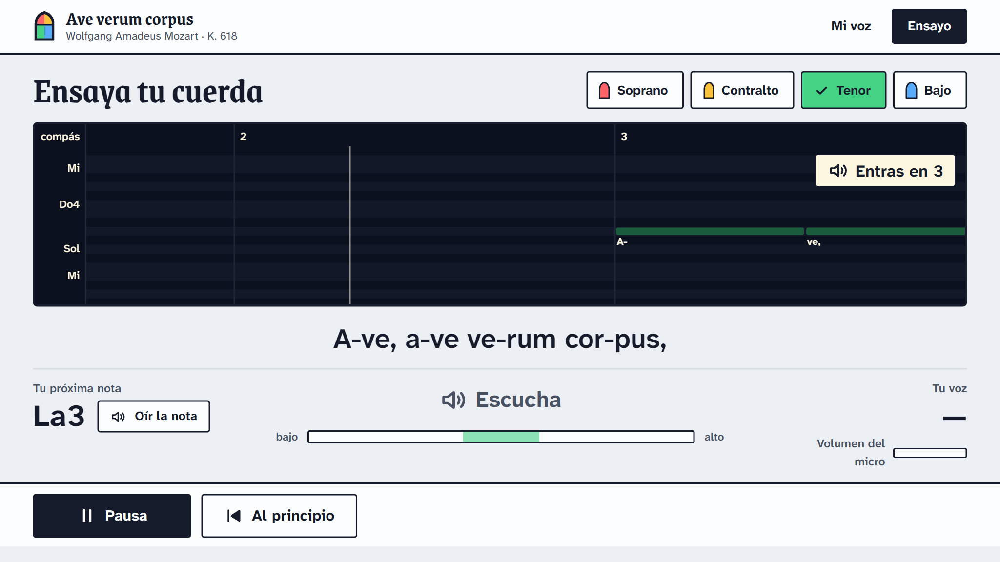

### 6. Canta y mira tu voz

La raya vertical es el «ahora» y las notas van llegando hacia ella desde la derecha. Tu voz es la línea de luz: si va por dentro de la barra, la nota se enciende.

Debajo tienes el marcador:

- **Toca cantar**: la nota que pide la partitura. Con «Oír la nota» te la da.
- **El veredicto y la aguja**: «Afinado», o hacia dónde te has ido.
- **Tu voz**: la nota que estás cantando de verdad.


### 7. Si te corrige, hazle caso

Cuando te quedas bajo, dice **«Sube un poco»** con una flecha hacia arriba; cuando te pasas, **«Baja un poco»**. La aguja te enseña cuánto. Lo dice siempre con palabra y flecha, no solo con color.

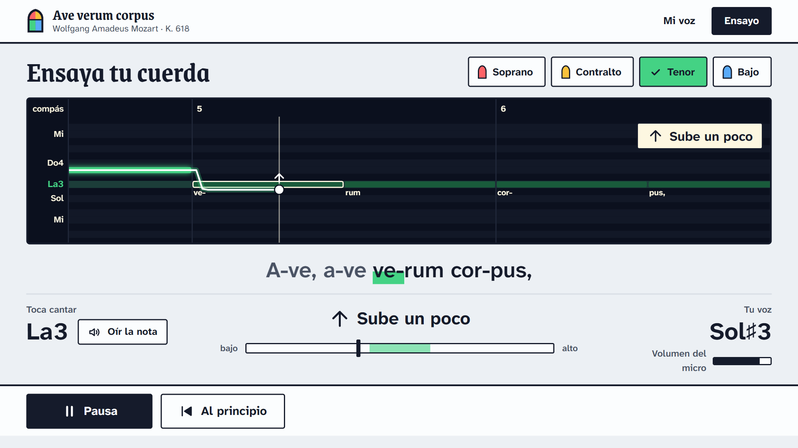

### 8. Para y lee el resumen

Pulsa **«Pausa»** cuando quieras. Más abajo aparece el resumen, frase a frase: un cristal encendido por cada nota afinada y una flecha en las que hay que subir o bajar.

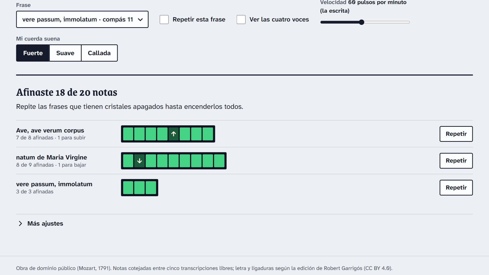

### 9. Repite la frase que se te resiste

Pulsa **«Repetir»** junto a una frase y sonará en bucle. Después de cada pasada verás cuántas notas has afinado. Si va muy deprisa, baja la **velocidad** (de 40 a 84 pulsos por minuto).

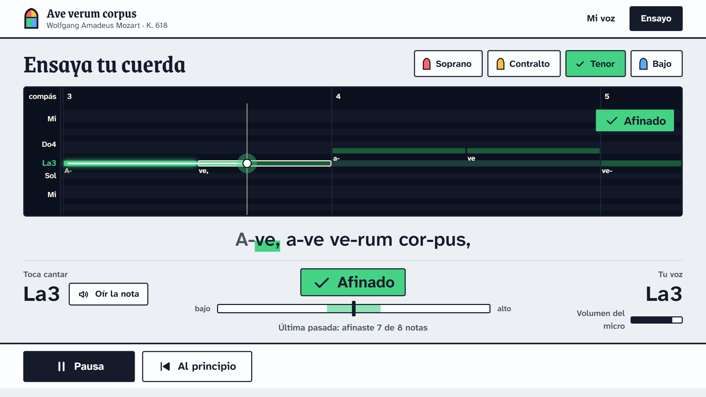

## Más cosas que puedes hacer

**Ver las cuatro voces.** Marca «Ver las cuatro voces» y verás cómo se mueven las demás cuerdas alrededor de la tuya, cada una con su color.

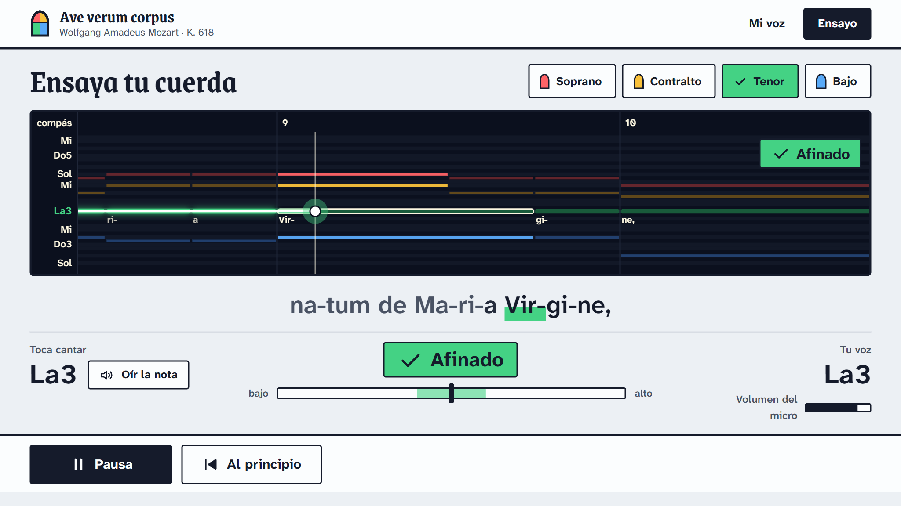

**Decidir cuánto te ayuda tu propia cuerda.** En «Mi cuerda suena» eliges *fuerte* para aprenderla, *suave* para apoyarte o *callada* para cantarla solo contra las demás.

**Más ajustes.** Al final de la pantalla:

| Ajuste | Para qué sirve |
|---|---|
| Qué más suena | Quitar o poner cada voz y las cuerdas, y añadir una claqueta. |
| Tono de la obra | Subir o bajar todo hasta 6 semitonos si no llegas a alguna nota. |
| Micrófono | Elegir cuál usar y decir si llevas auriculares. |
| Cómo te corrijo | Modo exigente (menos margen) y dar por buena la nota una octava arriba o abajo. |

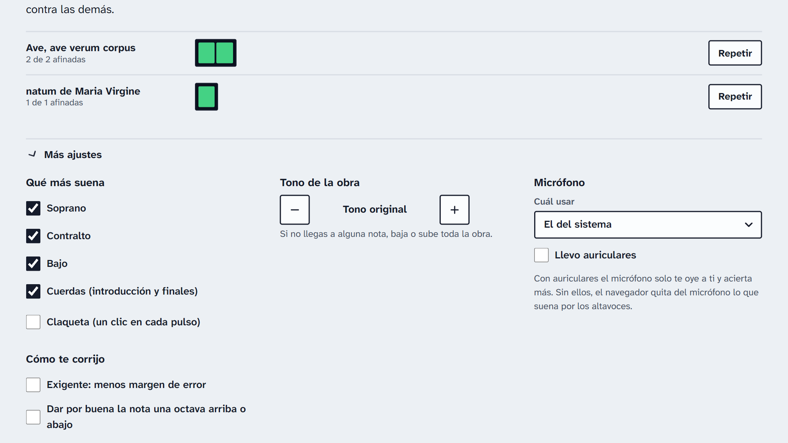

### Consejos

- Mejor con auriculares: así el micrófono solo te oye a ti. Márcalo en «Más ajustes».
- Con auriculares Bluetooth, usa el micrófono del ordenador y no el del auricular: si no, Windows baja la calidad del sonido.
- La barra espaciadora pone y quita la pausa.

### En el móvil

La misma dirección sirve en el teléfono. La pantalla se reordena en vertical.

<p align="center">
  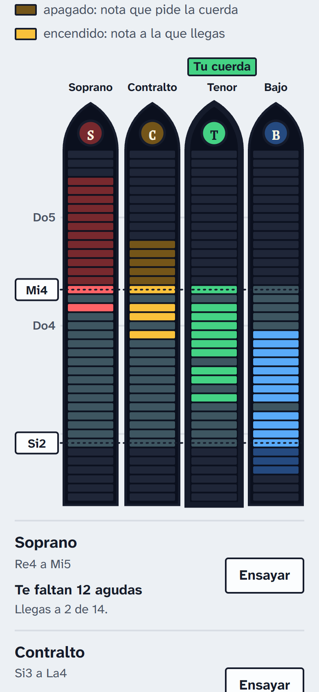
  &nbsp;&nbsp;
  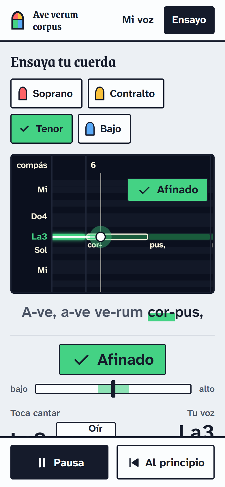
</p>

## Instalarla en tu ordenador

No hace falta para usarla, pero puedes tenerla en local. Solo necesitas [Node.js](https://nodejs.org) 18 o posterior; no hay nada más que instalar.

```bash
git clone https://github.com/joseAveleira/ensayo-coral.git
cd ensayo-coral
npm start
```

Se abre en `http://localhost:3000`. En Windows también vale un doble clic en `iniciar.bat`. Para pararla, Ctrl + C en la ventana del servidor.

Otras órdenes:

| Orden | Qué hace |
|---|---|
| `node server.js --no-abrir` | Arranca sin abrir el navegador. |
| `node server.js --puerto 8080` | Usa otro puerto. |
| `npm run validar` | Comprueba las partituras y el detector de tono. |
| `npm run web` | Deja en `_site/` la versión estática, lista para cualquier alojamiento. |

## Cómo funciona

No hay servidor que procese nada: todo ocurre en el navegador.

- **Tono de la voz**: algoritmo YIN sobre la señal del micrófono (`public/js/tono.js`). Con tonos sintéticos de Mi2 a Do6 falla por menos de 1 cent.
- **Corrección**: mide cuánto tiempo de cada nota pasa tu voz dentro del margen (50 cents; 30 en modo exigente) y la da por afinada, alta, baja o sin voz (`public/js/evaluacion.js`).
- **Sonido**: coro y cuerdas sintetizados con Web Audio, con un filtro y una posición en el estéreo por voz y reverberación generada (`public/js/sintetizador.js`).
- **Publicación**: cada cambio en `main` se publica solo en GitHub Pages (`.github/workflows/pages.yml`).

| Archivo | Qué hay |
|---|---|
| `public/` | La aplicación: HTML, CSS y JavaScript sin compilar. |
| `public/js/tono.js` | Micrófono y detección de tono. |
| `public/js/sintetizador.js` | El coro y las cuerdas. |
| `public/js/evaluacion.js` | Decide si cada nota salió afinada, alta o baja. |
| `public/js/rollo.js` | La partitura en movimiento (canvas). |
| `public/js/ventanal.js` | Los cuatro ventanales de la prueba de voz (SVG). |
| `public/js/voz.js`, `ensayo.js`, `app.js` | Las dos pantallas y el arranque. |
| `partituras/` | Una obra por archivo JSON. |
| `server.js` | Servidor local `node:http`, sin dependencias. |
| `tools/` | Validación de partituras y preparación de la web estática. |

El diseño visual, «Vidriera», está descrito en [DESIGN.md](DESIGN.md).

## Añadir otra obra

Deja otro `.json` en `partituras/` con el mismo formato que `ave-verum-mozart.json`:

- `voces[].notas`: lista de `[pulso de inicio, duración en pulsos, nota MIDI, sílaba]`. La sílaba es `null` en las notas que siguen un melisma.
- `frases[]`: texto de cada frase y cuántas sílabas tiene; con eso se reparte la letra en cada voz.
- `acompanamiento[]`: partes instrumentales, sin sílabas.

Solo música de dominio público.

## Estado

- Está probada de principio a fin con una voz simulada (un tono que canta la partitura), en local y en la web publicada. Las capturas y la animación de este documento salen de esa prueba.
- Falta ajustarla con voces reales: el margen de afinación y el filtro de ruido pueden necesitar retoques.
- En tamaño de móvil está comprobada la disposición, no el uso en un teléfono real.
- Las tipografías se cargan de Google Fonts. Sin conexión funciona igual, con la letra del sistema.

## Créditos

- Música: *Ave verum corpus*, K. 618, de W. A. Mozart, 1791 (dominio público).
- Partitura: notas cotejadas entre cinco transcripciones libres. La letra y las ligaduras siguen la edición de [Robert Garrigós](https://garrigos.cat), con licencia [CC BY 4.0](https://creativecommons.org/licenses/by/4.0/deed.es), adaptada aquí a JSON.
- Tipografías: Atkinson Hyperlegible Next y Grenze (SIL Open Font License), servidas por Google Fonts.

Hecha por [Jose Aveleira](https://github.com/joseAveleira) con [Claude Code](https://claude.com/claude-code), como demostración de lo que se puede construir programando con inteligencia artificial.

## Licencia

El código es libre y gratuito, con licencia [MIT](LICENSE): puedes usarlo, copiarlo, modificarlo y repartirlo como quieras, también con fines comerciales, siempre que conserves el aviso de copyright. La partitura del *Ave verum* conserva su propia licencia CC BY 4.0 (ver «Créditos»).
