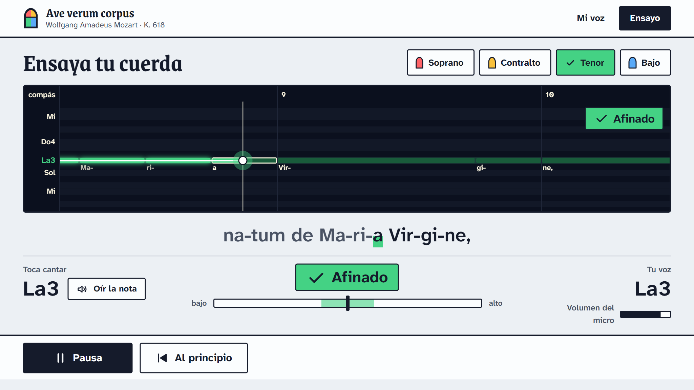
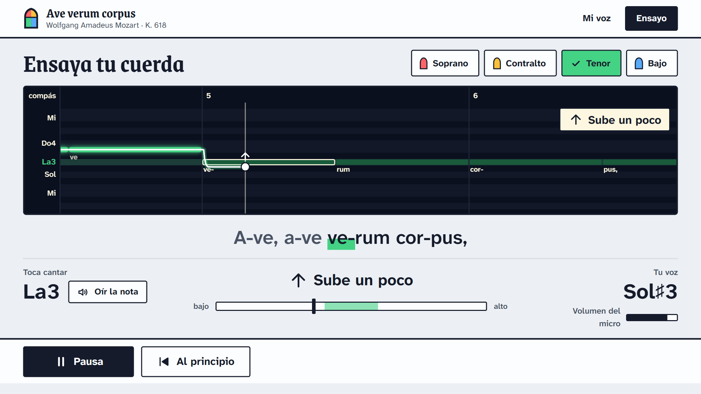
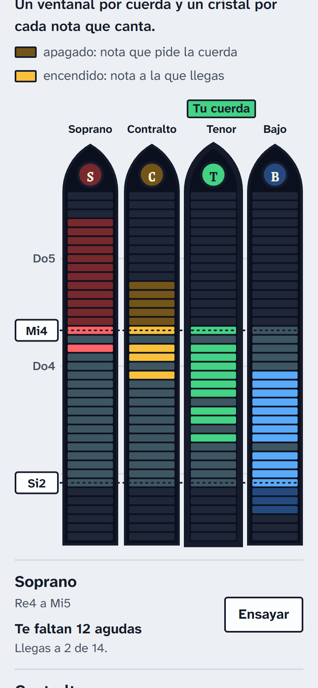

# Ensayo coral

Ensaya tu cuerda de coro con el micrófono. La aplicación escucha tu voz, la dibuja en tiempo real sobre las notas de tu cuerda y te dice si vas afinado, alto o bajo, mientras suenan las otras voces.

Primera obra: *Ave verum corpus* de Mozart (K. 618), a cuatro voces.



Está hecha con Node.js y JavaScript, sin dependencias y sin paso de compilación. Todo el sonido se sintetiza en el navegador: no hay grabaciones.

## Qué hace

### Mi voz: ¿a qué cuerda llegas?

Cantas tu nota más grave y la más aguda. Cuatro ventanales, uno por cuerda, se encienden cristal a cristal hasta donde llega tu voz. La aplicación te dice qué cuerda te encaja y cuántas notas te faltan en las demás.


### Ensayo: canta sobre las otras voces

- Suenan las cuatro voces y las cuerdas. Tu propia cuerda puede sonar fuerte, suave o callada.
- Tu voz es una línea de luz sobre las notas de tu cuerda. Cada nota se enciende cuando la afinas.
- Si no la afinas, te lo dice con una palabra y una flecha: «Sube un poco» o «Baja un poco». El estado nunca depende solo del color.
- La letra avanza sílaba a sílaba y una cuenta atrás te avisa de cuándo entras.
- Puedes repetir una frase en bucle, cambiar la velocidad (de 40 a 84 pulsos por minuto) y subir o bajar el tono de toda la obra hasta 6 semitonos.
- Al parar, un resumen frase a frase te enseña qué notas quedaron altas o bajas.




### En el móvil

<p>
  
  
</p>

## Arrancar

Hace falta [Node.js](https://nodejs.org) 18 o posterior. No hay nada que instalar.

```bash
git clone https://github.com/joseAveleira/ensayo-coral.git
cd ensayo-coral
npm start
```

Se abre en `http://localhost:3000`. En Windows también vale un doble clic en `iniciar.bat`. Para pararla, Ctrl + C en la ventana del servidor.

Otras opciones: `node server.js --no-abrir` (no abre el navegador) y `node server.js --puerto 8080`.

## Consejos de uso

- Mejor con auriculares: así el micrófono solo te oye a ti. Si los llevas, márcalo en «Más ajustes».
- Con auriculares Bluetooth, usa el micrófono del ordenador y no el del auricular: si no, Windows baja la calidad del sonido.
- Si no llegas a alguna nota, baja o sube el tono de toda la obra en «Más ajustes».

## Cómo funciona

- **Tono de la voz**: algoritmo YIN sobre la señal del micrófono (`public/js/tono.js`). Con tonos sintéticos de Mi2 a Do6 falla por menos de 1 cent.
- **Corrección**: mide cuánto tiempo de cada nota pasa tu voz dentro del margen (50 cents; 30 en modo exigente) y la da por afinada, alta, baja o sin voz (`public/js/evaluacion.js`).
- **Sonido**: coro y cuerdas sintetizados con Web Audio, con un filtro y una posición en el estéreo por voz y reverberación generada (`public/js/sintetizador.js`).
- **Servidor**: `node:http` sin dependencias. Sirve `public/` y la API `/api/partituras` (`server.js`).

| Archivo | Qué hay |
|---|---|
| `server.js` | Servidor y API de partituras. |
| `partituras/` | Una obra por archivo JSON. |
| `public/js/tono.js` | Micrófono y detección de tono. |
| `public/js/sintetizador.js` | El coro y las cuerdas. |
| `public/js/evaluacion.js` | Decide si cada nota salió afinada, alta o baja. |
| `public/js/rollo.js` | La partitura en movimiento (canvas). |
| `public/js/ventanal.js` | Los cuatro ventanales de la prueba de voz (SVG). |
| `public/js/voz.js`, `ensayo.js`, `app.js` | Las dos pantallas y el arranque. |
| `tools/validar-partitura.mjs` | Comprueba las partituras y el detector de tono (`npm run validar`). |

El diseño visual, «Vidriera», está descrito en [DESIGN.md](DESIGN.md).

## Añadir otra obra

Deja otro `.json` en `partituras/` con el mismo formato que `ave-verum-mozart.json`:

- `voces[].notas`: lista de `[pulso de inicio, duración en pulsos, nota MIDI, sílaba]`. La sílaba es `null` en las notas que siguen un melisma.
- `frases[]`: texto de cada frase y cuántas sílabas tiene; con eso se reparte la letra en cada voz.
- `acompanamiento[]`: partes instrumentales, sin sílabas.

Solo música de dominio público.

## Estado

- Está probada de principio a fin con una voz simulada (un tono que canta la partitura), en escritorio y en tamaño de móvil. Las capturas de arriba salen de esa prueba.
- Falta ajustarla con voces reales: el margen de afinación y el filtro de ruido pueden necesitar retoques.
- El navegador solo deja usar el micrófono en `localhost` o con https. Para usarla desde un móvil hay que servirla con https.
- Las tipografías se cargan de Google Fonts. Sin conexión funciona igual, con la letra del sistema.

## Créditos

- Música: *Ave verum corpus*, K. 618, de W. A. Mozart, 1791 (dominio público).
- Partitura: notas cotejadas entre cinco transcripciones libres. La letra y las ligaduras siguen la edición de [Robert Garrigós](https://garrigos.cat), con licencia [CC BY 4.0](https://creativecommons.org/licenses/by/4.0/deed.es), adaptada aquí a JSON.
- Tipografías: Atkinson Hyperlegible Next y Grenze (SIL Open Font License), servidas por Google Fonts.

Hecha por [Jose Aveleira](https://github.com/joseAveleira) con [Claude Code](https://claude.com/claude-code), como demostración de lo que se puede construir programando con inteligencia artificial.
